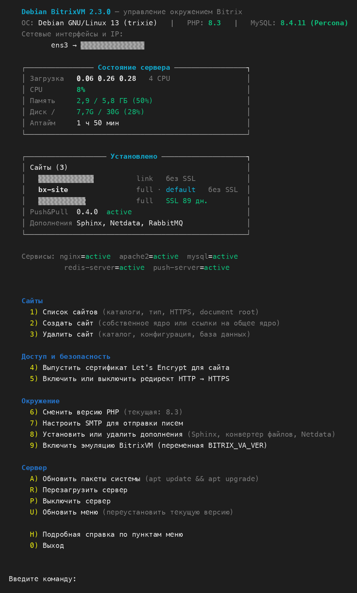

# **Asosiy menyu**


# **Ma'lumot**
Bitrix muhiti boshqaruvi uchun menyu, **Debian 12 / Debian 13** uchun moslashtirilgan. Asosiy maqsad — Debian 13 (trixie): loyiha zamonaviy Debian mashinalarida CentOS 9 muhitini almashtiradi.  
(YogSottot) bitrix-gt](https://github.com/YogSottot/bitrix-gt) loyihasi asosida ishlab chiqilgan va **zamonaviy Debian 12–13 hamda Bitrix** uchun optimallashtirilgan.

---

# **Muhit imkoniyatlari**
- Barcha kerakli komponentlarning to'liq avtomatik o'rnatilishi:  
  **Ansible, PHP 8.3 (standart), MySQL 8.4 LTS, Nginx, Apache, Redis, Push & Pull serveri.**
- **MB dvigatelini tanlash: Oracle MySQL 8.4 LTS yoki Percona Server 8.4 LTS** (`DB_ENGINE` o‘zgaruvchisi).
- **Kompozit qo‘llab-quvvatlanishi**.
- Statik fayllarni **Brotli orqali berish**.
- Standart konfiguratsiyalarni o'zgartirmasdan **shaxsiy Nginx konfiguratsiyalaridan foydalanish** imkoniyati.
- **Sphinx bilan to'liq matn qidiruvini** qo‘llab-quvvatlash.
- **Hujjatlarni konvertatsiya qilish serverini (`LibreOffice`, `ImageMagick`) o‘rnatish va sozlash** imkoniyati.
- **Netdata o‘rnatish va monitoring qilish** imkoniyati.

---

# **Menyu imkoniyatlari**
- Saytlar ro‘yxatini ko‘rish.
- Saytlarni **yadro va simbolik havola rejimida** yaratish va o‘chirish.
- Yadro rejimida sayt yaratilganda agentlarni **CRON-ga** avtomatik o‘tkazish.
- **Let’s Encrypt SSL sertifikatlarini** chiqarish.
- **HTTP → HTTPS yo‘naltirishini boshqarish**.
- **PHP versiyalarini o‘zgartirish**.
- **SMTP sozlash** (umumiy yoki har bir sayt uchun alohida).
- **Serverni yangilash, qayta ishga tushirish va o‘chirish**.
- Yangi menyu versiyasi chiqishi haqida bildirish.
- **Bitta buyruq bilan menyuni yangilash**:
  ```bash
  update_menu
  ```

---

# **O‘rnatish**
### ⚠ **Muhim:** Menyuni **faqat root foydalanuvchi sifatida** o‘rnatish va ishlatish tavsiya etiladi.

#### **Debian 12 / Debian 13 uchun to‘liq muhitni o‘rnatish**
##### `CURL` orqali o‘rnatish
```bash
apt install -y curl wget && bash <(curl -sL https://raw.githubusercontent.com/Bx-Project-Hub/DebianBitrixVM/master/install_full_environment.sh)
```
##### `WGET` orqali o‘rnatish
```bash
apt install -y curl wget && bash <(wget -qO- https://raw.githubusercontent.com/Bx-Project-Hub/DebianBitrixVM/master/install_full_environment.sh)
```

---

## Ma’lumotlar bazasi dvigatelini tanlash: MySQL yoki Percona Server
O‘rnatuvchi **Oracle MySQL 8.4 LTS** yoki **Percona Server for MySQL 8.4 LTS** ni tanlash imkonini beradi. Ikkalasi ham bir xil xizmat (`mysql.service`), bir xil konfiguratsiya katalogi (`/etc/mysql/conf.d/99-bitrix.cnf`) va bir xil autentifikatsiya rejimidan (`mysql_native_password`) foydalanadi, shu sababli Bitrix ikkala holatda ham bir xil ishlaydi.

```bash
# Interaktiv tanlov (standart — MySQL)
bash <(curl -sL https://raw.githubusercontent.com/Bx-Project-Hub/DebianBitrixVM/master/install_full_environment.sh)

# Percona Server 8.4 LTS, savolsiz
DB_ENGINE=percona bash <(curl -sL https://raw.githubusercontent.com/Bx-Project-Hub/DebianBitrixVM/master/install_full_environment.sh)

# Oracle MySQL 8.4 LTS, savolsiz
DB_ENGINE=mysql bash <(curl -sL https://raw.githubusercontent.com/Bx-Project-Hub/DebianBitrixVM/master/install_full_environment.sh)
```

**Toza Debian 13 (trixie), amd64 da tekshirildi:** PHP 8.3.36 (tizimdagi yagona PHP tarmog‘i), MySQL/Percona 8.4.11, Nginx 1.26.3, Apache 2.4.69, Node.js 20.19.2, push-server 0.4.0; barcha xizmatlar faol; sayt yaratish `full` va `link` rejimlarida ishlaydi.

---

# **Menyuni yangilash**
Agar yangi menyu versiyasi chiqqan bo‘lsa, uni **bitta buyruq bilan yangilash mumkin**:
```bash
update_menu
```
Menyuni `CURL` yoki `WGET` orqali qo‘lda ham yangilash mumkin.  
Yangilash jarayonida joriy versiya **avtomatik ravishda zaxiraga olinadi** `/root/backup_vm_menu/DD.MM.YYYY HH:MM:SS`.

#### **`CURL` orqali yangilash**
```bash
bash <(curl -sL https://raw.githubusercontent.com/Bx-Project-Hub/DebianBitrixVM/master/update_menu.sh)
```
#### **`WGET` orqali yangilash**
```bash
bash <(wget -qO- https://raw.githubusercontent.com/Bx-Project-Hub/DebianBitrixVM/master/update_menu.sh)
```

---

# **Foydalanish**
Menyu **`/root/vm_menu`** katalogiga o‘rnatiladi va **simvolik havola** yaratiladi:
- `/root/menu.sh` → `/root/vm_menu/menu.sh`

Menyuni quyidagi buyruqlar bilan ishga tushirish mumkin:
```bash
./menu.sh   # Agar /root katalogida bo‘lsangiz
/root/menu.sh   # Boshqa katalogdan ishga tushirish uchun
```
Shuningdek, menyu yo‘li **avtomatik ravishda `.profile`-ga qo‘shiladi**, shuning uchun **SSH** ulanishi bilan darhol ishga tushadi.

---

# **Sozlamalar**
Menyu moslashuvchan va sozlash mumkin.  
Barcha parametrlarni quyidagi faylda o‘zgartirish mumkin:
```bash
/root/vm_menu/bash_scripts/config.sh
```
Standart holatda barcha sozlamalar optimal, ammo zarurat bo‘lsa, muhitni o‘zingizga moslashtirishingiz mumkin.

---

# **Yangilanishlar va yangi imkoniyatlar**
Menyu avtomatik ravishda **yangi versiyalar haqida xabar beradi**.  
Uni quyidagi buyruq bilan yangilash mumkin:
```bash
update_menu
```
Agar menyu tajribalar yoki o‘zgartirishlar natijasida buzilgan bo‘lsa — **yangilashni ishga tushiring**, va u **ishlaydigan versiyaga qaytadi**.

---

# **Qo‘llab-quvvatlash, lokalizatsiya va takliflar**
Savollaringiz yoki takliflaringiz bo‘lsa, qo‘shiling:
[**Telegram qo‘llab-quvvatlash guruhi**](https://t.me/bitrix_ferma)

