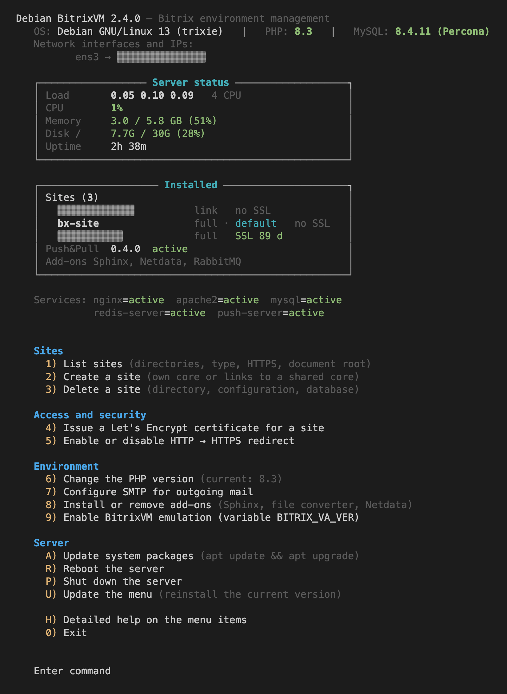

# **Asosiy menyu**

**Til:** [RU](README.md) · [EN](README_en.md) · [UK](README_uk.md) · [KZ](README_kz.md) · [AZ](README_az.md) · **UZ** · [TM](README_tm.md) · [TJ](README_tj.md) · [KA](README_ka.md)



# **Ma'lumot**
Bitrix muhiti boshqaruvi uchun menyu, **Debian 12 / Debian 13** uchun moslashtirilgan. Asosiy maqsad — Debian 13 (trixie): loyiha zamonaviy Debian mashinalarida CentOS 9 muhitini almashtiradi.  
Muhit **1C-Bitrix rasmiy hujjatlari** asosida yig‘ilgan — [«Debian 13 uchun muhitni sozlash»](https://dev.1c-bitrix.ru/learning/course/index.php?COURSE_ID=32) kursi (paketlar, Nginx, PHP, Apache, MySQL/MariaDB, PostgreSQL, Redis, push-server) — va Bitrix mahsulotlarining rasmiy tizim talablariga mos. Avtomatlashtirish **standart Ansible sxemasi** bo‘yicha qurilgan (`playbooks/` + `roles/`: `defaults`, `vars`, `tasks`, `meta`), faqat `ansible.builtin` modullari ishlatiladi, tashqi kolleksiyalarsiz.

---

# **Muhit imkoniyatlari**
- Barcha kerakli komponentlarning to'liq avtomatik o'rnatilishi:  
  **Ansible, PHP 8.3 (standart), MySQL 8.4 LTS, Nginx, Apache, Redis, Push & Pull serveri.**
- **MB dvigatelini tanlash: Oracle MySQL 8.4 LTS yoki Percona Server 8.4 LTS** (`DB_ENGINE` o‘zgaruvchisi).
- **Kompozit qo‘llab-quvvatlanishi**.
- Statik fayllarni **Brotli orqali berish**.
- Standart konfiguratsiyalarni o'zgartirmasdan **shaxsiy Nginx konfiguratsiyalaridan foydalanish** imkoniyati.
- **Sphinx bilan to'liq matn qidiruvini** qo‘llab-quvvatlash.
- **Hujjatlarni konvertatsiya qilish serverini (`LibreOffice`, `ImageMagick`) o‘rnatish va sozlash** imkoniyati.
- **Netdata o‘rnatish va monitoring qilish** imkoniyati.

---

# **Menyu imkoniyatlari**
- Saytlar ro‘yxatini ko‘rish.
- Saytlarni **yadro va simbolik havola rejimida** yaratish va o‘chirish.
- Yadro rejimida sayt yaratilganda agentlarni **CRON-ga** avtomatik o‘tkazish.
- **Let’s Encrypt SSL sertifikatlarini** chiqarish.
- **HTTP → HTTPS yo‘naltirishini boshqarish**.
- **PHP versiyalarini o‘zgartirish**.
- **SMTP sozlash** (umumiy yoki har bir sayt uchun alohida).
- **Serverni yangilash, qayta ishga tushirish va o‘chirish**.
- Yangi menyu versiyasi chiqishi haqida bildirish.
- **Bitta buyruq bilan menyuni yangilash**:
  ```bash
  update_menu
  ```
- **Ikki interfeys tili — rus va ingliz** — tizim lokaliga qarab avtomatik tanlanadi (`ru_*` → rus tili, boshqalari → ingliz tili); `BS_MENU_LANG` o‘zgaruvchisi bilan majburan belgilash mumkin.
- **Bitrix uchun PostgreSQL** — qo‘shimchalar menyusidan o‘rnatish va o‘chirish, `postgresql.conf` presetlari RAM hajmiga qarab tanlanadi.

---

# **O‘rnatish**
### ⚠ **Muhim:** Menyuni **faqat root foydalanuvchi sifatida** o‘rnatish va ishlatish tavsiya etiladi.

#### **Debian 12 / Debian 13 uchun to‘liq muhitni o‘rnatish**
##### `CURL` orqali o‘rnatish
```bash
apt install -y curl wget && bash <(curl -sL https://raw.githubusercontent.com/Bx-Project-Hub/DebianBitrixVM/master/install_full_environment.sh)
```
##### `WGET` orqali o‘rnatish
```bash
apt install -y curl wget && bash <(wget -qO- https://raw.githubusercontent.com/Bx-Project-Hub/DebianBitrixVM/master/install_full_environment.sh)
```

---

## Ma’lumotlar bazasi dvigatelini tanlash: MySQL yoki Percona Server
O‘rnatuvchi **Oracle MySQL 8.4 LTS** yoki **Percona Server for MySQL 8.4 LTS** ni tanlash imkonini beradi. Ikkalasi ham bir xil xizmat (`mysql.service`), bir xil konfiguratsiya katalogi (`/etc/mysql/conf.d/99-bitrix.cnf`) va bir xil autentifikatsiya rejimidan (`mysql_native_password`) foydalanadi, shu sababli Bitrix ikkala holatda ham bir xil ishlaydi.

```bash
# Interaktiv tanlov (standart — MySQL)
bash <(curl -sL https://raw.githubusercontent.com/Bx-Project-Hub/DebianBitrixVM/master/install_full_environment.sh)

# Percona Server 8.4 LTS, savolsiz
DB_ENGINE=percona bash <(curl -sL https://raw.githubusercontent.com/Bx-Project-Hub/DebianBitrixVM/master/install_full_environment.sh)

# Oracle MySQL 8.4 LTS, savolsiz
DB_ENGINE=mysql bash <(curl -sL https://raw.githubusercontent.com/Bx-Project-Hub/DebianBitrixVM/master/install_full_environment.sh)
```

**Toza Debian 13 (trixie), amd64 da tekshirildi:** PHP 8.3.36 (tizimdagi yagona PHP tarmog‘i), MySQL/Percona 8.4.11, Nginx 1.26.3, Apache 2.4.69, Node.js 20.19.2, push-server 0.4.0; barcha xizmatlar faol; sayt yaratish `full` va `link` rejimlarida ishlaydi.

## RAM hajmiga qarab MySQL/Percona konfiguratsiya presetlari

O‘rnatish paytida ma’lumotlar bazasi parametrlari operativ xotira hajmiga qarab avtomatik tanlanadi (`MemTotal`, `/proc/meminfo`).

| RAM, GB | Bufer puli | Temp jadvallar | Redo jurnal | Log buferi |
|-----|-----|-----|-----|-----|
| <3 | 768M | 64M | 512M | 32M |
| 3&#8209;6 | 1536M | 96M | 768M | 64M |
| 6&#8209;12 | 3072M | 128M | 1G | 96M |
| 12&#8209;24 | 6144M | 128M | 2G | 128M |
| 24&#8209;48 | 12288M | 256M | 4G | 256M |
| ≥48 | 24576M | 256M | 8G | 256M |

| RAM, GB | Ulanishlar | Jadval keshi | Oqim keshi | IO |
|-----|-----|-----|-----|-----|
| <3 | 40 | 2000 | 64 | 400&nbsp;/&nbsp;800 |
| 3&#8209;6 | 60 | 4000 | 96 | 600&nbsp;/&nbsp;1200 |
| 6&#8209;12 | 80 | 8000 | 128 | 1000&nbsp;/&nbsp;2000 |
| 12&#8209;24 | 85 | 14336 | 128 | 2000&nbsp;/&nbsp;4000 |
| 24&#8209;48 | 200 | 20000 | 256 | 3000&nbsp;/&nbsp;6000 |
| ≥48 | 300 | 32768 | 256 | 4000&nbsp;/&nbsp;8000 |

Preset birinchi mos chegaraga qarab tanlanadi; o‘zgaruvchi bilan majburan belgilash mumkin:

```bash
MYSQL_PRESET=8g DB_ENGINE=percona bash <(curl -sL https://raw.githubusercontent.com/Bx-Project-Hub/DebianBitrixVM/master/install_full_environment.sh)
```

Ruxsat etilgan qiymatlar: `2g`, `4g`, `8g`, `16g`, `32g`, `64g` (standart — `auto`). Parametrlar `/etc/mysql/conf.d/10-bitrix-memory.cnf` fayliga yoziladi.

## Bitrix portali uchun PostgreSQL

Menyudan o‘rnatiladi: `8` → «Qo‘shimcha komponentlar» → `4`. MySQL ishlashda davom etadi — MB tanlovi portal o‘rnatishda amalga oshiriladi.

| RAM, GB | Bufer puli | Rejalashtiruvchi keshi | work_mem | Xizmat ko‘rsatish |
|---|---|---|---|---|
| <3 | 512MB | 1536MB | 4MB | 128MB |
| 3&#8209;6 | 1GB | 3GB | 6MB | 256MB |
| 6&#8209;12 | 2GB | 6GB | 8MB | 512MB |
| 12&#8209;24 | 4GB | 12GB | 12MB | 1GB |
| 24&#8209;48 | 8GB | 24GB | 16MB | 1GB |
| ≥48 | 16GB | 48GB | 24MB | 2GB |

| RAM, GB | Ulanishlar | WAL buferi | Temp buferi |
|---|---|---|---|
| <3 | 40 | 16MB | 8MB |
| 3&#8209;6 | 60 | 16MB | 8MB |
| 6&#8209;12 | 80 | 16MB | 16MB |
| 12&#8209;24 | 85 | 16MB | 24MB |
| 24&#8209;48 | 200 | 16MB | 32MB |
| ≥48 | 300 | 16MB | 48MB |

Parametrlarning to‘liq nomlari: bufer puli — `shared_buffers`, rejalashtiruvchi keshi — `effective_cache_size`, xizmat ko‘rsatish — `maintenance_work_mem`, ulanishlar — `max_connections`, WAL buferi — `wal_buffers`, temp buferi — `temp_buffers`.

Avtomatik yaratiladi: `bitrix` bazasi (`LC_CTYPE='C.UTF-8' TEMPLATE template0`), `bitrix` foydalanuvchisi, `public` sxemasiga `GRANT CREATE`, `pgcrypto` kengaytmasi, `pg_hba.conf` da parol autentifikatsiyasi.

Preset birinchi mos chegaraga qarab tanlanadi; majburan — `config.sh` dagi `BS_POSTGRES_PRESET`.

## Ichiga olingan bog‘liqliklar (`vendor/`)

Ilgari begona saytlardan yuklanadigan hamma narsa repozitoriyda — `vendor/`: nginx gzip/zstd
modullari (Debian-da yo‘q), push&pull serveri, Bitrix-ning PHP/Nginx/Apache konfiguratsiyalari,
Bitrix o‘rnatish skriptlari, Netdata o‘rnatish skripti va repozitoriy kalitlari. O‘rnatuvchi
`vendor` jildini `/root/vendor` ga ko‘chiradi, `vendor/CHECKSUMS.sha256` ni tekshiradi va
fayllarni o‘sha yerdan oladi; tarmoq faqat mahalliy nusxa bo‘lmaganda ishlatiladi. Yangilash —
`tools/vendor-fetch.sh`, tekshirish — `tools/vendor-fetch.sh --check`. Debian, deb.sury.org,
MySQL/Percona va Netdata repozitoriylari ataylab tashqi bo‘lib qoladi: ular paket va xavfsizlik
yangilanishlari manbai, ichiga olingan nusxalar darhol eskirardi.

---

# **Menyuni yangilash**
Agar yangi menyu versiyasi chiqqan bo‘lsa, uni **bitta buyruq bilan yangilash mumkin**:
```bash
update_menu
```
Menyuni `CURL` yoki `WGET` orqali qo‘lda ham yangilash mumkin.  
Yangilash jarayonida joriy versiya **avtomatik ravishda zaxiraga olinadi** `/root/backup_vm_menu/DD.MM.YYYY HH:MM:SS`.

#### **`CURL` orqali yangilash**
```bash
bash <(curl -sL https://raw.githubusercontent.com/Bx-Project-Hub/DebianBitrixVM/master/update_menu.sh)
```
#### **`WGET` orqali yangilash**
```bash
bash <(wget -qO- https://raw.githubusercontent.com/Bx-Project-Hub/DebianBitrixVM/master/update_menu.sh)
```

---

# **Foydalanish**
Menyu **`/root/vm_menu`** katalogiga o‘rnatiladi va **simvolik havola** yaratiladi:
- `/root/menu.sh` → `/root/vm_menu/menu.sh`

Menyuni quyidagi buyruqlar bilan ishga tushirish mumkin:
```bash
./menu.sh   # Agar /root katalogida bo‘lsangiz
/root/menu.sh   # Boshqa katalogdan ishga tushirish uchun
```
Shuningdek, menyu yo‘li **avtomatik ravishda `.profile`-ga qo‘shiladi**, shuning uchun **SSH** ulanishi bilan darhol ishga tushadi.

---

# **Sozlamalar**
Menyu moslashuvchan va sozlash mumkin.  
Barcha parametrlarni quyidagi faylda o‘zgartirish mumkin:
```bash
/root/vm_menu/bash_scripts/config.sh
```
Standart holatda barcha sozlamalar optimal, ammo zarurat bo‘lsa, muhitni o‘zingizga moslashtirishingiz mumkin.

### Interfeys tili

Menyu ikki tilli: rus va ingliz. Til tizim lokaliga qarab avtomatik tanlanadi:
`ru_RU.UTF-8` (yoki har qanday `ru_*`) — rus tili; boshqa har qanday, jumladan `uz_UZ.UTF-8`
va `C.UTF-8` — ingliz tili.

Majburan tanlash — muhit o‘zgaruvchisi yoki `config.sh` faylidagi `BS_MENU_LANG` parametri:

```bash
BS_MENU_LANG=en /root/menu.sh   # rus lokali serverda ingliz tili
BS_MENU_LANG=ru /root/menu.sh   # ingliz lokali serverda rus tili
```

Interfeysning barcha satrlari bitta faylda saqlanadi — `/root/vm_menu/bash_scripts/i18n.sh`
(`MSG_RU` va `MSG_EN` lug‘atlari).

---

# **Yangilanishlar va yangi imkoniyatlar**
Menyu avtomatik ravishda **yangi versiyalar haqida xabar beradi**.  
Uni quyidagi buyruq bilan yangilash mumkin:
```bash
update_menu
```
Agar menyu tajribalar yoki o‘zgartirishlar natijasida buzilgan bo‘lsa — **yangilashni ishga tushiring**, va u **ishlaydigan versiyaga qaytadi**.

---

# **Qo‘llab-quvvatlash, lokalizatsiya va takliflar**
Savollaringiz yoki takliflaringiz bo‘lsa, qo‘shiling:
[**Telegram qo‘llab-quvvatlash guruhi**](https://t.me/bitrix_ferma)

